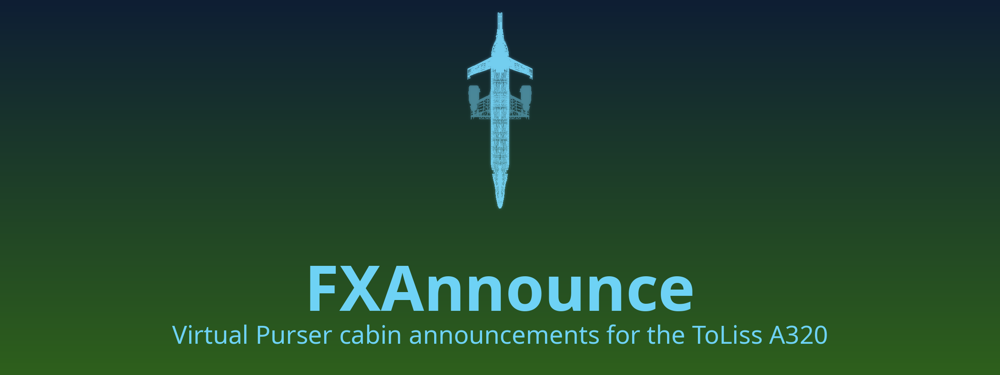

# FXAnnounce
<div align="center">


**Automatic cabin announcements for the ToLiss A319, A320 and A321 in X-Plane 12.**

<a href="https://www.x-plane.com/"></a>
<a href="https://claude.ai/"></a>
<a href="https://www.gnu.org/licenses/gpl-3.0.en.html"></a>
</div>


FXAnnounce acts as a virtual purser. It plays the cabin announcements of community *Airline Packs* (made for the Fenix A320 in MSFS) at the right moments of the flight, without you pressing anything: boarding music and welcomes at
the gate, the safety briefing, cabin checks, cabin dimming, the after-takeoff and descent calls, and deboarding.

> **Status: early release (0.2.x).** The plugin is still being tested in the simulator. The ToLiss signals that
> follow the flight phases are being verified (see *Known limitations*). If something plays at the wrong time, the
> log tells you why; please include it in a bug report.

## Features
- **Chooses the pack for you.** The pack is matched from the livery, a SimBrief plan, the MCDU flight number or the
  livery name.
- **Follows the flight.** It reads the ToLiss doors, seatbelt and beacon signs, the FMGS and ECAM data, the
  thrust levers, the speedbrakes and the ACP knobs.
- **Boards on schedule.** With a SimBrief plan, boarding starts 30–40 min before departure, depending on the aircraft
  and the load. Without a plan, it starts when a passenger door opens at the gate.
- **Plays the right call.** Each announcement file has tags (aircraft type, time of day, refuelling, flight phase,
  variant, custom livery tags). FXAnnounce picks the best match, following the Fenix rules.
- **Realistic sound.** The PA is quieter behind a closed cockpit door, follows the ToLiss volume and the ACP PA
  knob, and sounds different from the exterior view.
- **Cabin calls to the cockpit.** A call from the cabin chimes in the cockpit and waits until you pull the CAB knob
  on the ACP, as in the Fenix.
- **Pauses with the sim.** Audio stops when you pause and resumes from the same point.

## Requirements
**Needed**
- X-Plane 12 (the window uses Panel Graphics on X-Plane **12.4.4-R1** and later, with an OpenGL fallback on older versions (NOT TESTED)).
- The ToLiss A319, A320 or A321 (CEO or NEO). ToLiss A320 NEO 1.3 and A321 CEO 1.8 or later are recommended.
- Airline Packs in the Fenix format. They are third-party content and **not included**. Put them in
  `X-Plane 12/Resources/plugins/AirlinePacks/`.

> **Use Announcement Hangar (Cabin Announcements For Fenix)** 
> This is a discord server that hosts Airline Packs for the Fenix A320 in MSFS. The packs are free to download.

**Optional**
- [simbrief_hub](https://github.com/hotbso/simbrief_hub) with your SimBrief Pilot ID. It supplies the plan
  (departure time, airline, flight number, passengers). FXAnnounce doesn't download anything itself.

**Not needed:** any other ToLiss add-on. FXAnnounce reads the ToLiss datarefs directly. Discrepancies may happen with other announcement mods, please disable them before running FXAnnounce.

## Install
1. Download the latest `FXAnnounce-x.y.z.zip` from the [Releases page](https://github.com/Yosh145/fxannounce/releases)
   and extract it. One zip works on Linux, Windows and macOS (Intel and Apple Silicon).
2. Copy both folders, `FXAnnounce` and `AirlinePacks`, into `X-Plane 12/Resources/plugins/`. If you already have an
   `AirlinePacks` folder, let them merge: nothing of yours is replaced.
3. Put your Airline Packs into `X-Plane 12/Resources/plugins/AirlinePacks/`. Each pack is a folder named with the
   airline's ICAO code (`DLH`, `BAW`…), plus an optional `Default` folder.
4. Start X-Plane and load a ToLiss A319, A320 or A321. If you add packs later, use the `fxannounce/rescan` command.
5. FXAnnounce stays dormant on every other aircraft. The A330 and A340 are planned for a later version.

**Updating:** replace the `FXAnnounce` folder. Your settings are kept.

**macOS:** the plugin isn't notarized by Apple. If X-Plane reports that FXAnnounce can't be opened or verified, run
this once in Terminal (adjust the path to your X-Plane folder), then restart X-Plane:
```
xattr -dr com.apple.quarantine "/Applications/X-Plane 12/Resources/plugins/FXAnnounce"
```

## Choosing a pack for a livery
In this order, the plugin goes:
1. **Per-livery file:** `airlinepack.cfg` in the livery folder:
   ```
   airline = BAW
   custom_tags = WiFi,USB
   overwater = no
   ```
2. **Central mapping:** `AirlinePacks/liveries.ini`, keyed by a pattern on the livery folder name:
   ```
   [British Airways*]
   airline = BAW
   ```
3. **SimBrief plan:** its callsign (such as `BAW123`), when the plan starts at this airport.
4. **Flight number** entered in the MCDU (`BAW123` or `BA123`).
5. **Livery folder name:** for example "Lufthansa (D-AIJB)" → DLH.
6. **`Default`** pack, if you have one.

Sounds from different packs are never mixed.

## Using it
- **Window:** Plugins → FXAnnounce → Show/hide window, or bind the `fxannounce/window_toggle` command.
  - **Status:** what the cabin is doing, what plays now and next, and why this pack was chosen.
  - **Timeline:** past and upcoming announcements.
  - **Packs:** every installed pack and file with its parsed tags, a Play button for each file, and an explanation of
    what would play now and why.
  - **Settings:** every option, applied with Apply.
  - **Inspector:** raw ToLiss values and a guided probe checklist.
  - **Log.**
- **Commands** (bind them in X-Plane's keyboard settings):
  - `fxannounce/skip`: stop the current announcement.
  - `fxannounce/advance`: fire the next event now.
  - `fxannounce/mute_toggle`.
  - `fxannounce/overwater_toggle`: enable `[Overwater]` announcements for this flight.
  - `fxannounce/rescan`: look for new packs and files.
- **Boarding** starts by itself, in one of three ways:
  - with a SimBrief plan for this airport, 30–40 min before departure (longer for an A321 and for a fuller cabin),
    using X-Plane's clock;
  - if you load in after that time, or have no plan: when a passenger door has been open for 15 s at the gate with
    power on;
  - at once when you press a cabin call button (FWD, AFT, ALL…) on the overhead CALLS panel at the gate.

  Settings → Cabin → **Boarding starts** can switch to doors only, or to cabin call only. A cabin call after the doors
  are armed, or during the descent, makes the cabin finish its safety check quickly.
- **Settings file:** `Output/preferences/FXAnnounce.ini`.
- **Log:** `Output/FXAnnounce.log`. Turn on **Record flight trace** to also write a CSV trace to `Output/FXAnnounce/`.
  Traces can contain your SimBrief or account details, so check them before you share them.

## What's new
See [CHANGELOG.md](CHANGELOG.md) for the changes in each version.

## Known limitations
- **Not yet confirmed in the simulator.** The ToLiss flight-phase encodings (ECAM and QPAC phases, thrust-lever
  values, ground spoilers) come from community reference material and are being checked with probe flights.
- **Phase estimate without FMGS.** If the FMGS isn't initialized, FXAnnounce estimates the flight phase from the
  aircraft's state. Short flights still get the main calls, but timing is less precise.
- **Overwater** is set per flight from the livery config or the command, not from the route.
- **No changes to the aircraft.** FXAnnounce only reads ToLiss values and never writes to them.
- **A330 and A340** are not supported yet.

## Build from source
```
cmake -S native -B build -G Ninja
cmake --build build
cmake --build build --target fx_tests fx_ui_tests && ./build/fx_tests && ./build/fx_ui_tests
```
The plugin is written to `build/FXAnnounce/<platform>/FXAnnounce.xpl`. Releases are built by CI from a version
tag (`docs/ARCHITECTURE.md` § 6). Developers: see `docs/` for the behaviour
spec (`VP_SPEC.md`), the design (`ARCHITECTURE.md`), the ToLiss datarefs (`TOLISS_DATAREFS.md`) and the in-sim
checklist (`ACCEPTANCE.md`).

## Credits
- **Fenix Simulations:** the Airline Packs format and the cabin announcement rules that FXAnnounce follows. FXAnnounce
  is not affiliated with Fenix.
- **ToLiss:** the A319, A320 and A321 for X-Plane.
- **X-Airbus by FrankLFRS:** the names and value meanings of several ToLiss datarefs were checked against this FlyWithLua
  library. No code is copied from it.
- **simbrief_hub by hotbso:** the SimBrief plan interface.
- **Dear ImGui, ImgWindow, libogg, libvorbis, doctest** and the **X-Plane SDK** (Laminar Research).
- Thanks to the Airline Pack makers for their packs.

## License
FXAnnounce is licensed under the GNU General Public License v3.0 (see `LICENSE`).
Airline Packs and ToLiss aircraft are third-party content and are not included or covered by this license.
FXAnnounce is not affiliated with Laminar Research, ToLiss or Fenix Simulations.
